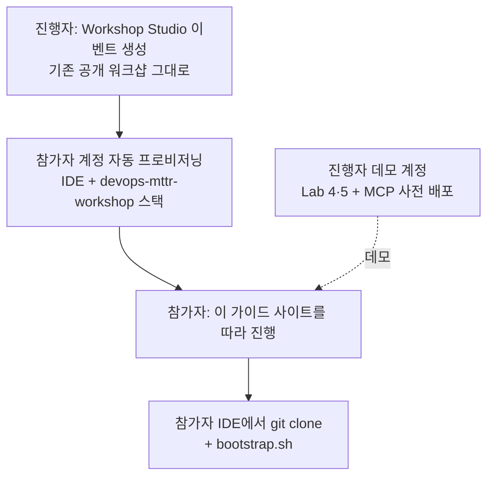

# 진행자 가이드

## 운영 방식

- **워크샵을 새로 publish할 필요가 없습니다.** Workshop Studio에서 기존 공개 워크샵으로 이벤트만 만들면 됩니다.
- 참가자는 이 가이드를 보며 진행하고, 확장 실습 코드는 IDE 터미널에서 `git clone` 으로 받습니다. 이 저장소가 public이라 인증이 필요 없습니다.

## 타이밍 시트

| 시각 | 진행자 행동 | 참가자 상태 | 백업 |
|---|---|---|---|
| 0:00 | 아젠다, 오늘의 네 가지 질문 → **Agent Space 생성 버튼부터 누르게** | 접속, Agent Space 생성 중 | 접속 문제: Event access code 재배포 |
| 0:10 | `git clone` + `bootstrap.sh` 안내 | 저장소 받기 | clone 실패 시 tarball 명령 |
| 0:15 | ECS 조사 시작 → **기다리는 동안 Topology 시연** | 조사 중 (약 5분) | 완료된 조사 화면 캡처 |
| 0:25 | Root cause → Mitigation "조치 없음"의 의미 → spec | 결과 확인 | |
| 0:40 | Webhook 발급 → Lambda 설정 → Method 1 트리거 | 설정 | 늦으면 Method 2 |
| 0:50 | 자동 생성된 조사 + 메타데이터, "외부 요인" 결론 → 판별 화두 | 결과 확인 | |
| 0:58 | RCA 반박 미니 실습, Q3·Q4·Q5 답변 | 채팅 재조사 | |
| 1:03 | **Lab 3 리셋 명령 실행 지시** → 휴식 | 리셋 실행 | |
| 1:10 | 패턴 설명 + 라우팅 토론 (10분) | 듣기 | |
| 1:20 | Lab 3 **Run SRE Agent** 만 누르게 하기 | 대시보드 실행 | 대시보드 녹화본 |
| 1:25 | 메인 에이전트 실습: `router.py start` → -26%가 조사 없이 닫히는 것 확인 | 실습 | [사전 검증 결과](test-report.md#router) |
| 1:30 | 코드 읽기: `devops_agent_tool.py` (API 3개), `triage()`, `domain_agent.py` → Lab 3 대시보드 확인 | 코드 리뷰 | |
| 1:40 | `router.py finish --wait` → 도메인 에이전트의 ACCEPT/REJECT 근거 읽기 | 실습 | 사전 검증 `results.jsonl` |
| 1:50 | `evaluate.py` 로 판별·라우팅 정확도 측정 → "측정이 어려웠던 이유" 토론 | 실습 | |
| 1:55 | Lab 4·5 핵심 화면 (Memory, trace), 확장 A·B 소개 | 시청 | trace 캡처 |
| 2:00 | Discovery 시작 | 토론 | |

## 사전 준비 체크리스트

**Workshop Studio**

- [ ] 이벤트 생성 (us-east-1). 참석자 수 + 여유 계정 확보, Event access code 준비
- [ ] 리허설로 소요 시간 확인: ECS 조사 약 5분, Lab 3 리셋 약 7분, Lab 3 전체 10–15분
- [ ] **참가자 계정에서 `register-service`(MCP, A2A 등록)가 허용되는지 확인** → [리스크](risks.md)
- [ ] 참가자 계정에서 `router.py start` 가 조사를 생성하는지 확인 (`create_backlog_task` 권한)
- [ ] 이벤트 계정에서 GitHub 접근(`git clone`)이 되는지 확인

**진행자 데모 계정 (D-1까지)**

- [ ] Lab 4 Runtime + Memory(Long-term, 과거 인시던트 시딩) + Observability 배포
- [ ] CloudWatch **Transaction Search** 활성화. span이 보이기까지 최대 10분이 걸리므로 미리 켜두기
- [ ] Lab 5 Reactive/Proactive 트리거 구성, PR이 생성된 화면 확보
- [ ] 확장 B: `deploy.sh` → `register.sh` → 두 샘플(-26%, -62%)로 조사를 실행해 결과 화면 확보
- [ ] 백업 자료: 완료된 조사 화면, Lab 3 대시보드 녹화, trace 캡처

**참석자 사전 요청**

- [ ] 최근 인시던트 2–3건의 타임라인과 포스트모템
- [ ] 현재 에이전트 구조도, 라우팅 로직 개요

**오픈 아이템**

- [ ] 공개 사례 RCA 정확도 수치의 측정 기준 확인 후 공유
