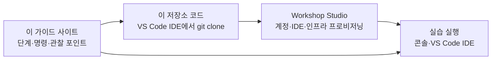

# AWS DevOps Agent 실습 워크샵

AWS DevOps Agent의 기능을 **직접 써보면서** 우리 조직의 장애 대응에 어떻게 적용할지 정리하는 3시간짜리 워크샵입니다.

| 시간 | 파트 | 내용 | 형태 |
|---|---|---|---|
| 0:00–0:15 | 시작하기 | 환경 접속, Agent Space 생성, 이 저장소 내려받기 | 실습 |
| 0:15–1:05 | [Part 1 · 기본 기능](part1/index.md) | 장애 조사 → RCA → Mitigation, 알람 자동 트리거, 피드백 루프 | 실습 |
| 1:05–1:10 | 휴식 | (휴식 직전에 Lab 3 환경 리셋 실행) | – |
| 1:10–2:00 | [Part 2 · 기존 Agent 연결](part2/index.md) | 멀티에이전트에서 DevOps Agent 호출, 판별·라우팅, 아키텍처 설명 | 실습 |
| 2:00–3:00 | [Part 3 · Discovery](part3/index.md) | 고객 상황 듣기 → 신뢰 기준 → PoC 범위 합의 | 토론 |

!!! abstract "워크샵 참가 (Join)"
    

    **[https://bit.ly/4hTUWKA](https://bit.ly/4hTUWKA)** 로 접속하거나 오른쪽 QR 코드를 스캔하세요. Event access code가 링크에 포함되어 있어 바로 참가 화면이 열립니다.

    1. **Email one-time-password (OTP)** 로 로그인
    2. 약관 동의 → **Join event**
    3. 왼쪽 사이드바 **Open AWS console** → 그다음 [환경 준비](setup.md)

## 이 가이드를 쓰는 방법

이 워크샵은 AWS 공개 워크샵 **"Extend Your Operations with Autonomous SRE"** 의 실습 환경을 그대로 사용합니다. **이 사이트만 보고 처음부터 끝까지 진행**할 수 있도록 단계와 명령을 모두 담았습니다.

- **원본 워크샵:** <https://catalog.us-east-1.prod.workshops.aws/workshops/a03aac5c-40f1-44c3-87ef-495507743b8b/en-US>
  실습 환경은 이 워크샵의 것을 그대로 쓰지만, **실행 단계와 명령은 모두 이 사이트에 들어 있습니다.** 원본 페이지는 열지 않아도 됩니다(참고용).
- **이 저장소:** 원본에 없는 확장 실습 코드(비즈니스 알림 트리거, 이벤트 컨텍스트 MCP, 정확도 평가)가 들어 있습니다.

!!! tip "브라우저 탭 3개면 충분합니다"
    ① 이 가이드 · ② Workshop Studio의 AWS 콘솔 · ③ VS Code IDE (모든 명령은 여기 터미널에서)

    → [환경 준비](setup.md)

## 오늘 다룰 질문

| 질문 | 어디서 보나 |
|---|---|
| **① RCA + 조치 제안:** 원인을 찾는 데 사람이 붙는 시간을 줄일 수 있나? | [Part 1 ECS 조사](part1/ecs.md), [Lab 3](part2/lab3.md) |
| **② 인시던트 판별:** 축구 경기 때문인가, 진짜 장애인가? | [메인 에이전트 실습](part2/ext-router.md) |
| **③ 라우팅의 신뢰성:** "A팀 문제"라고 근거를 갖고 말하고, 그 정확도를 잴 수 있나? | [메인 에이전트 실습](part2/ext-router.md) |
| **④ Slack 온디맨드 질의:** 리더십이 "괜찮아?"라고 바로 물을 수 있나? | [Part 3 Discovery](part3/index.md)에서 논의 |
