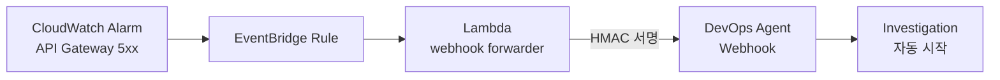

# ② 자동 트리거 · Proactive Investigation (0:40–0:58)



CloudWatch 알람, EventBridge 규칙, forwarder Lambda는 **이미 배포되어 있습니다.** 할 일은 웹훅을 발급해 Lambda에 넣고 알람을 울리는 것뿐입니다.

## 실습

### 1. 웹훅 발급 (콘솔, 2분)

1. [DevOps Agent 콘솔](https://console.aws.amazon.com/aidevops/home?region=us-east-1) → `api-error-incident-space` → **기능** 탭 (영어 콘솔: *Capabilities*)
2. **Webhooks** → **Add Webhook** → **Next** → **Next** → **Generate URL and secret key**
3. **.csv 파일을 다운로드**하고 *"I've saved and stored my URL and secret key"* 를 체크합니다.

!!! important "Secret은 이때 한 번만 보입니다"
    .csv 파일을 꼭 받아 두세요. Part 2의 [확장 A](../part2/ext-alert.md)에서도 같은 웹훅을 씁니다.

### 2. 웹훅 값을 환경 파일에 저장

**방법 A (권장): .csv 파일을 올려서 자동으로 저장**

1. 1번에서 받은 .csv 파일을 올립니다.
    - **CloudShell:** 오른쪽 위 **작업**(Actions) → **파일 업로드**(Upload file) → 홈 디렉터리(`~`)에 저장됨
    - **VS Code IDE:** 왼쪽 탐색기(Explorer)의 `/workshop` 폴더로 끌어다 놓기
2. 아래를 **그대로** 붙여 넣습니다. 바꿀 값은 없습니다.

```bash
CSV=$(ls ~/webhook-creds-*.csv /workshop/webhook-creds-*.csv 2>/dev/null | head -1); echo "$CSV"
python3 - "$CSV" <<'EOF'
import csv, os, re, sys
cells = [c.strip() for row in csv.reader(open(sys.argv[1], encoding="utf-8-sig")) for c in row]
url = next(c for c in cells if c.startswith("https://"))
secret = max((c for c in cells if c != url and " " not in c), key=len)
p = os.path.expanduser("~/.ext-workshop.env"); s = open(p).read()
s = re.sub(r"^export WEBHOOK_URL=.*$", "export WEBHOOK_URL=" + url, s, flags=re.M)
s = re.sub(r"^export WEBHOOK_SECRET=.*$", "export WEBHOOK_SECRET=" + secret, s, flags=re.M)
open(p, "w").write(s); print("saved")
EOF
source ~/.ext-workshop.env && echo "$WEBHOOK_URL"   # https://event-ai.us-east-1.api.aws/webhook/generic/... 가 나오면 OK
rm "$CSV"                                            # Secret이 담긴 파일이므로 삭제
```

??? note "방법 B: 값을 직접 붙여 넣기"
    따옴표 안의 `여기에_붙여넣기` 를 .csv 의 값으로 **바꾼 뒤** 실행합니다.

    ```bash
    URL='여기에_붙여넣기'
    SECRET='여기에_붙여넣기'
    sed -i "s#^export WEBHOOK_URL=.*#export WEBHOOK_URL=${URL}#; s#^export WEBHOOK_SECRET=.*#export WEBHOOK_SECRET=${SECRET}#" ~/.ext-workshop.env
    source ~/.ext-workshop.env && echo "$WEBHOOK_URL"
    ```

!!! warning "`syntax error near unexpected token` 이 나오면"
    예전 안내의 `<URL>` 같은 자리표시를 그대로 실행해 환경 파일이 깨진 것입니다. 방법 A를 실행하면 해당 줄이 올바른 값으로 덮어써져 해결됩니다.

### 3. forwarder Lambda에 웹훅 설정

```bash
FUNCTION_NAME=$(aws cloudformation describe-stacks --stack-name cloudformation-template \
  --query 'Stacks[0].Outputs[?OutputKey==`WebhookForwarderFunctionName`].OutputValue' --output text)
aws lambda update-function-configuration --function-name "$FUNCTION_NAME" \
  --environment "Variables={WEBHOOK_URL=${WEBHOOK_URL},WEBHOOK_SECRET=${WEBHOOK_SECRET}}" \
  --query LastUpdateStatus --output text
aws lambda wait function-updated --function-name "$FUNCTION_NAME" && echo "Lambda 설정 완료"
```

### 4. 알람 울리기

```bash
ALARM_NAME=$(aws cloudformation describe-stacks --stack-name cloudformation-template \
  --query 'Stacks[0].Outputs[?OutputKey==`ProactiveInvestigationAlarmName`].OutputValue' --output text)
aws cloudwatch set-alarm-state --alarm-name "$ALARM_NAME" --state-value ALARM \
  --state-reason "Manual test trigger - simulating production alarm"
sleep 15
aws logs tail /aws/lambda/$FUNCTION_NAME --since 5m --format short | grep -iE "webhook|incident"
```

로그에 `Incident ID: ...` 와 `Webhook request sent successfully`(또는 `Webhook request sent, response not verified`)가 보이면 성공입니다. `WEBHOOK_URL not configured` 가 보이면 3번을 다시 실행하세요.

??? note "실제 5xx 오류로 울리고 싶다면 (선택, 2–3분)"
    알람 상태를 직접 바꾸는 대신, mock API Gateway를 만들어 진짜 5xx를 발생시키는 방법도 있습니다. 시간이 남는 분만 [원본 Method 1](https://catalog.us-east-1.prod.workshops.aws/workshops/a03aac5c-40f1-44c3-87ef-495507743b8b/en-US/exercises/lab1/proactive-investigation/trigger-observe)을 참고하세요. 이 가이드의 사전 검증은 위의 방법으로 했습니다.

### 5. 자동으로 생긴 조사 확인

Operator access 웹앱(①에서 연 탭)을 새로고침하면 **아무도 버튼을 누르지 않았는데** *"Proactive Investigation: cloudformation-template-api-5xx-errors"* 가 생겨 있습니다. (선택) 터미널에서도 볼 수 있습니다.

```bash
aws devops-agent list-backlog-tasks --agent-space-id "$AGENT_SPACE_ID" \
  --query 'tasks[].[title,status]' --output table
```

!!! info "결과는 알람을 울린 시점에 따라 두 가지입니다 (리허설에서 둘 다 확인)"
    DevOps Agent는 들어온 알람을 **최근 약 20분 안에 진행 중인 조사**와 비교해, 같은 장애면 묶고(Linked) 아니면 새 조사를 만듭니다([공식 문서](https://docs.aws.amazon.com/devopsagent/latest/userguide/production-operations-autonomous-incident-response.html#incident-triage)).

    | 언제 울렸나 | 결과 | 볼 곳 |
    |---|---|---|
    | ①의 ECS 조사가 **이미 끝난 뒤** (워크샵 일정상 보통 이쪽) | **독립 조사**로 완료. 결론: *"Not a real incident. The alarm was manually forced into ALARM as a test"* | 인시던트 목록의 *Proactive Investigation: …api-5xx-errors* |
    | ①의 ECS 조사가 **진행 중일 때** | 알람 조사는 `LINKED`, ①의 ECS 조사가 알람 정보를 받아 다시 조사 | ①의 ECS 조사 **조사 타임라인**. 목록에서는 따로 안 보일 수 있음 |

    - **독립 조사일 때 볼 장면:** 알람 사유("Manual test trigger"), 실제 5xx 0건, 29초 만에 OK로 복귀한 사실을 근거로 **"사람이 강제로 울린 테스트 알람"이라고 판별**합니다. "진짜 인시던트인가?"라는 질문에 에이전트가 근거를 들어 답하는 장면입니다.
    - **LINKED일 때 볼 장면:** 알림이 쏟아질 때 **중복 조사를 막는 기능**입니다. "알림 노이즈" 질문에 답할 때 쓰세요.

## 관찰 포인트

| 무엇을 보나 | 왜 중요한가 |
|---|---|
| 메타데이터: `Source: webhook`, `Triggered By: lambda-automation` | 누가, 언제, 왜 조사를 시작했는지 **감사 추적**이 남습니다 |
| 조사 흐름: Context gathering → Data collection → Analysis → Root cause | 배포 이력과 설정 변경을 **먼저 배제**하고 결론을 냅니다 |
| 결론: *"Not a real incident … manually forced into ALARM as a test"* (배포·설정 변경·실제 오류를 먼저 확인) | 아래 "인시던트 판별" 참고 |

!!! question "Q. 자동 트리거 소스는 무엇이 되나요? Grafana나 Slack도 되나요?"
    대부분 됩니다. 원리는 **웹훅으로 HTTP POST를 보낼 수 있으면 무엇이든 트리거가 된다**는 것입니다.

    - **기본 연동:** CloudWatch, Datadog, Dynatrace, New Relic, Splunk, Grafana(알림 contact point), ServiceNow, PagerDuty, Slack
    - **Generic webhook:** 그 밖의 모든 시스템. 사내 비즈니스 메트릭 알림 시스템도 여기에 해당합니다 → [확장 A](../part2/ext-alert.md)에서 직접 해봅니다.
    - **MCP / A2A:** 기본 지원 목록에 없는 도구나 에이전트도 연결할 수 있습니다 → [Part 2](../part2/index.md)

## 인시던트 판별로 연결하기

이 시나리오의 결론은 *"실제 장애가 아니라 시험용으로 강제로 울린 알람"* 입니다. 에이전트가 **실제 오류 지표, 배포, 설정 변경을 먼저 확인해 배제한 뒤에** 판단을 내린 것입니다.

이 추론 구조가 바로 "진짜 장애인가, 예상된 변동인가"를 가리는 데 필요한 것입니다. 하지만 축구 경기 일정, 프로모션, 공휴일 같은 **비즈니스 맥락은 텔레메트리에 없습니다.** 그래서 에이전트에게 따로 알려줘야 합니다 → [확장 B · 이벤트 컨텍스트 MCP](../part2/ext-mcp.md)

!!! note "MTTR 수치에 대해"
    원본의 "19분 → 3분 (84% 감소)"는 **워크샵 시뮬레이션 기준 예시**입니다. 우리 환경에서 어떤 수치가 나올지는 Part 3에서 정의하는 평가 방법으로 측정해야 합니다.
