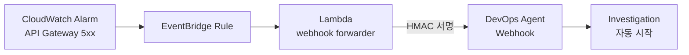

# ② 자동 트리거 · Proactive Investigation (0:40–0:58)

원본: [Lab 1 · Proactive Investigation with CloudWatch Alarms](https://catalog.us-east-1.prod.workshops.aws/workshops/a03aac5c-40f1-44c3-87ef-495507743b8b/en-US/exercises/lab1/proactive-investigation) → *Setup Automation* → *Trigger & Observe* → *Review Results*



## 진행 순서

1. **Webhook 발급:** Agent Space → **Capabilities** 탭 → Webhooks → **Add Webhook** → **Generate URL and secret key** → **.csv 다운로드**
2. **Lambda 환경변수 설정:** 원본 *Setup Automation* Step 2의 명령을 실행합니다. Lambda, Alarm, EventBridge Rule은 이미 배포되어 있습니다.
3. **트리거:** *Method 1*(실제 API Gateway 5xx 발생, 2–3분)을 권장합니다. 시간이 부족하면 *Method 2*(`set-alarm-state`, 약 10초)를 쓰세요.
4. **확인:** Operator access에 "Proactive Investigation: API-Gateway-5xx-Errors"가 **아무도 버튼을 누르지 않았는데** 생성되어 있습니다.

!!! important "Webhook URL과 Secret을 저장해 두세요"
    Part 2의 [확장 A](../part2/ext-alert.md)에서 다시 씁니다. Secret은 발급할 때 한 번만 보여줍니다.
    ```bash
    # CloudShell(또는 VS Code 터미널): ~/.ext-workshop.env 에 값을 채워 둡니다
    sed -i "s#^export WEBHOOK_URL=.*#export WEBHOOK_URL=<URL>#; s#^export WEBHOOK_SECRET=.*#export WEBHOOK_SECRET=<SECRET>#" ~/.ext-workshop.env
    source ~/.ext-workshop.env
    ```

## 관찰 포인트

| 무엇을 보나 | 왜 중요한가 |
|---|---|
| 메타데이터: `Source: webhook`, `Triggered By: lambda-automation` | 누가, 언제, 왜 조사를 시작했는지 **감사 추적**이 남습니다 |
| 조사 흐름: Context gathering → Data collection → Analysis → Root cause | 배포 이력과 설정 변경을 **먼저 배제**하고 결론을 냅니다 |
| 결론: *"No recent deployments, no config changes → external trigger or simulated condition"* | 아래 "인시던트 판별" 참고 |

!!! question "Q. 자동 트리거 소스는 무엇이 되나요? Grafana나 Slack도 되나요?"
    대부분 됩니다. 원리는 **웹훅으로 HTTP POST를 보낼 수 있으면 무엇이든 트리거가 된다**는 것입니다.

    - **기본 연동:** CloudWatch, Datadog, Dynatrace, New Relic, Splunk, Grafana(알림 contact point), ServiceNow, PagerDuty, Slack
    - **Generic webhook:** 그 밖의 모든 시스템. 사내 비즈니스 메트릭 알림 시스템도 여기에 해당합니다 → [확장 A](../part2/ext-alert.md)에서 직접 해봅니다.
    - **MCP / A2A:** 기본 지원 목록에 없는 도구나 에이전트도 연결할 수 있습니다 → [Part 2](../part2/index.md)

## 인시던트 판별로 연결하기

이 시나리오의 결론은 *"최근 배포도 설정 변경도 없으니 외부 요인이거나 시뮬레이션된 상황"* 입니다. 에이전트가 **배포와 설정 변경 가설을 배제한 뒤에** 판단을 내린 것입니다.

이 추론 구조가 바로 "진짜 장애인가, 예상된 변동인가"를 가리는 데 필요한 것입니다. 하지만 축구 경기 일정, 프로모션, 공휴일 같은 **비즈니스 맥락은 텔레메트리에 없습니다.** 그래서 에이전트에게 따로 알려줘야 합니다 → [확장 B · 이벤트 컨텍스트 MCP](../part2/ext-mcp.md)

!!! note "MTTR 수치에 대해"
    원본의 "19분 → 3분 (84% 감소)"는 **워크샵 시뮬레이션 기준 예시**입니다. 우리 환경에서 어떤 수치가 나올지는 Part 3에서 정의하는 평가 방법으로 측정해야 합니다.
