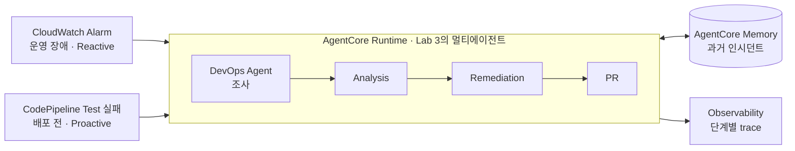

# Lab 4·5 아키텍처 (1:55–2:00, 5분)

진행자가 그림 하나로 설명합니다. 실습은 없습니다. 직접 해보려면 원본 [Lab 4](https://catalog.us-east-1.prod.workshops.aws/workshops/a03aac5c-40f1-44c3-87ef-495507743b8b/en-US/exercises/lab4) · [Lab 5](https://catalog.us-east-1.prod.workshops.aws/workshops/a03aac5c-40f1-44c3-87ef-495507743b8b/en-US/exercises/lab5)를 참고하세요.

| 볼 곳 | 한 줄 설명 |
|---|---|
| 왼쪽 트리거 2개 (Lab 5) | 같은 에이전트를 `invoke_agent_runtime()` 하나로 호출합니다. 바뀌는 건 연결 방식뿐입니다. |
| Memory (Lab 4) | 지난 사건의 결론을 다음 사건에 꺼내 씁니다. DevOps Agent 내장 Memory와는 별개입니다. |
| Observability (Lab 4) | "왜 이 팀에 보냈는가"를 나중에 감사할 원천 데이터입니다. 정답 라벨을 붙이면 [정확도 평가](ext-eval.md)의 입력이 됩니다. |
