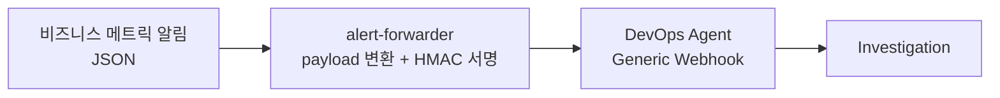

# 확장 A · 비즈니스 메트릭 알림으로 조사 시작하기

**목표:** CloudWatch 알람이 아니라 **사내 비즈니스 메트릭 알림**(노출수 급감, 주문 성공률 하락 등)에서 바로 DevOps Agent 조사를 시작합니다.

코드: [`extensions/alert-forwarder`](https://github.com/hsr87/devops-agent-workshop-kr/tree/main/extensions/alert-forwarder)



## 핵심: 에이전트에 무엇이 전달되나 {#payload}

공식 문서에 따르면 웹훅 payload의 **`title`, `description`, `priority`, 인시던트 참조만** 조사 컨텍스트로 쓰입니다. 자유 형식인 `data` 필드는 받기는 하지만 **에이전트에게 전달되지 않습니다.**

그래서 forwarder는 메트릭, 관측값과 기대값, 시간 범위, 관련 리소스, **판별 가이드**를 모두 `description` 에 글로 풀어 넣습니다.

```text
Metric: ad_impressions (service: ads-serving, market: KR)
Observed: 592.0 / Expected: 800 (-26% vs baseline)
Window: 2026-10-11T12:53:34Z ~ 2026-10-11T13:23:34Z
...
Investigation guidance:
1. Before concluding this is an incident, check whether the deviation is explained by
   external events ... call explain_deviation and list_external_events.
2. State a verdict: INCIDENT, EXPECTED_EVENT, or INCONCLUSIVE, with the evidence for it.
3. If INCIDENT, identify the owning service/team ... list the evidence ...
```

## 실습

Part 1 Proactive에서 받은 **Webhook URL과 Secret** 을 씁니다. Agent Space당 HMAC 웹훅은 하나만 만들 수 있으므로 같은 웹훅을 재사용합니다.

```bash
source ~/.ext-workshop.env        # WEBHOOK_URL / WEBHOOK_SECRET 이 채워져 있어야 함
cd /workshop/ext/extensions/alert-forwarder

# 1) 무엇이 전송되는지 먼저 확인
python3 send_test_alert.py samples/impressions-drop-during-match.json --dry-run

# 2) 실제 전송 → "Webhook received" (HTTP 200)
python3 send_test_alert.py samples/impressions-drop-during-match.json

# 3) 조사 생성 확인 (Operator access → Incidents 에서도 확인 가능)
aws devops-agent list-backlog-tasks --agent-space-id "$AGENT_SPACE_ID" \
  --query 'tasks[].[title,status,priority]' --output table
```

| 샘플 | 상황 | 기대하는 판별 |
|---|---|---|
| `impressions-drop-during-match.json` | 축구 경기 중 노출 -26% | **EXPECTED_EVENT** (경기 영향 -25%로 설명됨) |
| `impressions-crash-during-match.json` | 축구 경기 중 노출 -62% | **INCIDENT** (경기 영향을 빼고도 -49%) |
| `order-errors-spike.json` | 주문 성공률 -28% | **INCIDENT** → `commerce-order-team` 으로 라우팅 |
| `cloudwatch-alarm-event.json` | EventBridge 알람 이벤트 형식 | Lambda로 배포했을 때의 입력 예시 |

!!! note "판별 결과는 확장 B와 함께 써야 합니다"
    MCP 서버([확장 B](ext-mcp.md))가 연결되어 있지 않으면 에이전트는 경기 일정을 알 수 없습니다. 이때는 **INCONCLUSIVE** 가 나오거나, 텔레메트리만 보고 판단합니다. 같은 알림을 MCP 연결 전과 후에 각각 보내 결과를 비교해 보세요.

## 운영에 적용할 때

- **Lambda로 배포:** `WEBHOOK_URL=... WEBHOOK_SECRET=... ./deploy.sh` → `ext-alert-forwarder` 함수가 만들어집니다. 사내 알림 시스템이나 EventBridge에서 호출하면 됩니다.
- **인증 방식:** HMAC(기본, 위변조와 재전송 방지)과 API key(`AUTH_MODE=bearer`) 중에서 고를 수 있습니다. Agent Space마다 각 방식의 웹훅을 하나씩 만들 수 있습니다.
- **중복 제거:** `incidentId` 와 `timestamp` 가 같은 요청은 중복으로 보고 무시합니다. forwarder는 매번 고유한 ID를 만듭니다.
- **Grafana 알림**이라면 DevOps Agent의 **Grafana 기본 연동**(contact point)을 먼저 검토하세요.
