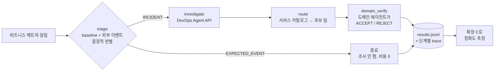

# 실습 · 메인 에이전트에 DevOps Agent 붙이기 (1:25–1:55)

**목표:** 지금 운영 중인 **메인+서브 에이전트 구조**를 축소한 예제로 아래 세 가지를 직접 해봅니다.

1. 판별과 라우팅은 **우리 코드가 결정적으로** 처리합니다.
2. 원인 분석(RCA)만 **DevOps Agent API를 tool로 호출**해 맡깁니다.
3. 단계마다 남긴 기록으로 **라우팅 정확도를 바로 측정**합니다.

코드: [`extensions/triage-router`](https://github.com/hsr87/devops-agent-workshop-kr/tree/main/extensions/triage-router) — 프레임워크 없이 순수 Python으로 작성했습니다. 사용하는 프레임워크(Strands, LangGraph, 사내 프레임워크)와 관계없이 그대로 옮길 수 있습니다.



| 노드 | 누가 결정하나 | 파일 |
|---|---|---|
| `triage` | **코드** (계절성 baseline과 이벤트 캘린더. 확장 B와 같은 로직) | `router.py` |
| `investigate` | **DevOps Agent** (`create_backlog_task` → 폴링 → 조사 기록 수집) | `devops_agent_tool.py` |
| `route` | **코드** (서비스 카탈로그의 owner) | `router.py` |
| `domain_verify` | **도메인 서브에이전트(LLM)**. RCA 근거가 자기 도메인을 가리키는지 판단하고, 아니면 다른 팀을 지목 | `domain_agent.py` |

!!! question "왜 이렇게 나누나요?"
    LLM이 한 번에 "장애인가, 누구 책임인가"를 정하면 **어느 단계에서 틀렸는지 알 수 없습니다.** 노드마다 입력과 출력을 남기면 판별 오류, RCA 오류, 라우팅 오류를 **따로 측정**할 수 있습니다. 측정이 어려웠던 문제를 구조로 푸는 방법입니다.

## 1) 알림 세 건 처리 시작 (1:25)

[Lab 3](lab3.md)의 **Run SRE Agent** 를 **먼저** 누르고, Lab 3의 Live Output에 `creating new task` 가 보인 **뒤에** 시작합니다(Lab 3은 진행 중인 조사를 재사용하기 때문입니다). 이 실습은 VS Code IDE의 **새 터미널**에서 합니다(Lab 3 `server.py` 가 첫 터미널을 쓰고 있음).

DevOps Agent 조사는 **12–25분** 걸립니다(사전 검증 실측). 그래서 `start` 를 먼저 해 두고 기다리는 동안 코드를 읽습니다.

**새 터미널을 열었다면 먼저** (터미널마다 한 번):

```bash
# ① Workshop Studio 사이드바 → Get AWS CLI credentials → Mac/Linux 의 export 줄을 먼저 붙여 넣고 Enter
# ② 실습 값 불러오기 + 자격 증명 확인
source ~/.ext-workshop.env
aws sts get-caller-identity --query Arn --output text
```

```bash
cd $EXT_REPO/extensions/triage-router
$EXT_PYTHON router.py start ../alert-forwarder/samples/impressions-drop-during-match.json \
                            ../alert-forwarder/samples/impressions-crash-during-match.json \
                            ../alert-forwarder/samples/order-errors-spike.json
```

```text
impressions-drop-during-match-…   triage=EXPECTED_EVENT  EXPLAINED_BY_EXTERNAL_EVENT  → closed without investigation (국가대표 축구 경기 생중계 …)
impressions-crash-during-match-…  triage=INCIDENT        UNEXPLAINED_ANOMALY  → DevOps Agent task bc0c… (PENDING_START)
order-errors-spike-…              triage=INCIDENT        UNEXPLAINED_ANOMALY  → DevOps Agent task c094… (PENDING_START)
```

- -26%는 경기 영향으로 설명되므로 **조사 자체를 시작하지 않습니다.** 예상된 변동에 비용을 쓰지 않습니다.
- 나머지 두 건만 DevOps Agent에 넘어갑니다. 콘솔의 **Operator access → Incidents** 에서도 보입니다.

## 2) 기다리는 동안: 코드 읽기 (1:30–1:45)

| 볼 곳 | 볼 것 |
|---|---|
| `devops_agent_tool.py` | DevOps Agent를 tool로 쓰는 데 필요한 API는 **세 개뿐**입니다. `create_backlog_task`, `get_backlog_task`, `list_journal_records`. `LINKED` 상태면 묶인 primary 조사를 따라갑니다. |
| `router.py` `triage()` | 판별은 LLM이 아니라 **규칙**입니다. 판정에 쓴 baseline, 잔차, 이벤트 이름이 trace에 남습니다. |
| `router.py` `investigate()` | 웹훅 경로(확장 A)와 **같은 description**(판별 가이드 포함)을 API로 보냅니다. `clientToken` 으로 중복 생성을 막습니다. |
| `domain_agent.py` | 도메인 에이전트의 판단 기준: **RCA가 확정한 원인**이 우리 서비스에 있으면 ACCEPT, 다른 팀이면 REJECT, 가설뿐이면 NEED_MORE_INFO. **"근거는 그 서비스 자체의 관측(메트릭, 로그, 코드, 배포)만 인정한다. 라우팅 규칙이나 다른 서비스의 텔레메트리는 근거가 아니다"**, **"RCA에 없는 근거는 지어내지 말라"** 도 지시합니다. 기존 서브에이전트 호출로 바꿀 자리입니다. |

```bash
$EXT_PYTHON router.py status      # DevOps Agent 조사 상태
cat runs/*.json | head -60        # 노드별 input / output / 소요 시간
```

!!! info "Lab 3과 같은 Agent Space를 씁니다"
    `order-errors-spike` 는 Lab 3이 조사 중인 order-api와 같은 서비스입니다. 그래서 DevOps Agent가 두 조사를 **같은 장애로 묶을(`LINKED`) 수 있습니다.** 그래도 라우터는 primary 조사의 결과를 가져오므로 그대로 진행됩니다.

## 3) 라우팅과 도메인 검증 (1:45–1:50)

```bash
$EXT_PYTHON router.py finish --wait     # 조사가 끝나면 route → domain_verify → results.jsonl
# 오래 걸리면 Ctrl+C 후 나중에 다시: $EXT_PYTHON router.py finish
```

```text
impressions-crash-during-match     INCONCLUSIVE    → ads-serving-team  [NEED_MORE_INFO]
impressions-drop-during-match      EXPECTED_EVENT  → ads-serving-team  [no RCA needed]
order-errors-spike                 INCIDENT        → commerce-order-team  [ACCEPT]
```

Workshop Studio 계정에서 실제로 나온 결과입니다(사전 검증). 세 시나리오가 각각 다른 판단을 보여줍니다.

| 알림 | 무슨 일이 있었나 | 볼 점 |
|---|---|---|
| 노출 -26% | 판별 단계에서 종료 | **조사 비용 0.** 경기 영향(-25%)으로 설명됨 |
| 노출 -62% | DevOps Agent가 order-api 등 계정 리소스를 배제하고, 원인 후보(입찰/집계)를 **가설로만** 제시 → 도메인 에이전트가 `NEED_MORE_INFO` | 이 계정에는 광고 시스템이 없습니다. **추측으로 담당 팀을 정하지 않는 것**이 정답입니다 |
| 주문 성공률 -28% | DevOps Agent가 원인을 확정: `POST /orders` 의 무제한 캐시(요청당 1MB), 배포 **뒤에** 도는 부하 테스트, 꺼진 circuit breaker 롤백 → 도메인 에이전트 `ACCEPT` | 근거(코드, 배포 이력, 파이프라인)가 **우리 서비스**를 가리킬 때만 받습니다 |

읽어 볼 것: `runs/*.json` 의 `domain_verify.reason`. 왜 받았는지, 왜 보류했는지가 근거와 함께 남습니다. 사전 검증에서 남은 예:

> **ACCEPT** — *"order-api task-def :2 was deployed by CodePipeline at 14:57:10Z and contains an unbounded 1MB-per-request cache in POST /orders. The post-deploy LoadTest flagged this leak, yet the revision stayed live because circuit breaker rollback=false. Both the code and the deployment process belong to commerce-order-team…"*
>
> **NEED_MORE_INFO** — *"The RCA confirms no cause … names ads-bidding (upstream, favored) and ads-tracking (downstream) only as hypotheses, with no confirming evidence…"*

!!! tip "판별 결과를 DevOps Agent에 넘기는 이유"
    `investigate()` 는 알림과 함께 **"이미 판별했다: 경기 영향을 빼고도 -49%. 원인에 집중하라"** 를 넘깁니다. 이 문장이 없을 때 DevOps Agent는 판별을 처음부터 다시 하려다 *"event-context MCP가 없어 분류할 수 없다"* 를 핵심 장애물로 기록했습니다. 메인 에이전트가 이미 아는 맥락은 **반드시 조사 요청에 담아 넘기세요.**

## 4) 바로 측정하기 (1:50–1:55)

라우터가 남긴 `results.jsonl` 은 [확장 C](ext-eval.md)가 읽는 형식 그대로입니다. 세 시나리오의 정답(`ground_truth.jsonl`)을 미리 넣어 두었습니다. **-62%의 정답은 `INCONCLUSIVE`** 입니다. 근거가 없을 때 "모른다"고 답하는 것을 정답으로 칩니다.

```bash
python3 ../rca-eval/evaluate.py ground_truth.jsonl results.jsonl
$EXT_PYTHON ../rca-eval/evaluate.py ground_truth.jsonl results.jsonl --judge   # RCA 일치도까지
```

```text
- Verdict accuracy (incident vs. expected event): 100.0% (3/3)
- Routing accuracy on true incidents: 100.0% (1/1)
- Root cause (LLM judge): MATCH 100.0% (1/1)

| order-errors-spike | INCIDENT | INCIDENT | OK | MATCH: The agent identifies the unbounded module-level cache in POST /orders (~1MB/request, never evicted). It also covers the leaky revision staying live … |
```

### 해보기: 도메인 에이전트의 기준을 바꾸면 숫자가 바뀝니다 (선택, 5분)

`domain_agent.py` 의 지시문이 라우팅 품질을 좌우합니다. 기준을 바꾼 뒤 **새 조사 없이** 라우팅과 검증만 다시 돌려 보세요(약 30초).

```bash
# 예: ACCEPT 조건을 "알림 메트릭의 하락까지 증명된 경우에만"으로 엄격하게 바꿔 본다
vi domain_agent.py
$EXT_PYTHON router.py finish --reverify
python3 ../rca-eval/evaluate.py ground_truth.jsonl results.jsonl
```

사전 검증에서 기준을 바꿀 때마다 결과가 이렇게 달라졌습니다.

| 도메인 에이전트 기준 | -62% | 주문 -28% | 판별 정확도 |
|---|---|---|---|
| ① 엄격: "알림 메트릭의 하락까지 증명돼야 ACCEPT" | NEED_MORE_INFO | **NEED_MORE_INFO** | 33% |
| ② "RCA가 확정한 원인이 우리 서비스에 있으면 ACCEPT" | 가끔 **ads-bidding으로 REJECT** | ACCEPT | 67–100% (조사마다 다름) |
| ③ ② + "라우팅 규칙·다른 서비스의 텔레메트리는 근거가 아니다" (현재) | NEED_MORE_INFO | ACCEPT | **100%** (조사 2세트 × 3회 반복 동일) |

②에서 -62%가 ads-bidding으로 넘어간 이유: DevOps Agent가 MCP의 라우팅 규칙("노출은 줄었는데 서빙 에러 없음 → 입찰 팀")을 읽고, **order-api의** "에러 없음" 메트릭을 근거처럼 썼기 때문입니다. 근거가 어느 서비스의 관측인지 따지지 않으면 **그럴듯한 오라우팅**이 생깁니다. 도메인 라우팅 신뢰성에서 가장 흔한 실패 패턴입니다.

!!! question "토론"
    - 엄격한 기준과 느슨한 기준 중 무엇이 맞을까요? 놓친 장애(엄격)와 오라우팅(느슨)의 비용이 다릅니다.
    - 단계별로 기록했기 때문에 **어느 단계의 기준을 바꿨는지, 그래서 숫자가 어떻게 바뀌었는지** 바로 보입니다. 지금 운영 중인 메인+서브 구조에서도 이 숫자를 따로 낼 수 있나요?

## 우리 구조에 대입하기

| 이 예제 | 운영 환경에서 바꿀 곳 |
|---|---|
| `triage()` 의 `explain_deviation` | 사내 이상 탐지와 이벤트 캘린더 |
| `route()` 의 서비스 카탈로그 | 사내 서비스 카탈로그, on-call 체계 |
| `domain_agent.ask()` | **기존 도메인 서브에이전트 호출** (HTTP, Lambda, A2A) |
| `devops_agent_tool.py` | 그대로 사용. 메인 에이전트에 tool 하나로 추가 |
| `runs/*.json` trace | AgentCore Observability 또는 사내 로그 저장소 |

!!! info "반대 방향(DevOps Agent → 기존 에이전트) 연결"
    DevOps Agent가 조사 도중 기존 에이전트를 직접 부르게 하려면 기존 에이전트를 **원격 A2A 에이전트**로 등록합니다(`register-service --service remoteagent`). Workshop Studio 계정에서는 계정 정책상 막혀 있지 않습니다. 다만 등록할 때 DevOps Agent가 **실제 A2A 엔드포인트의 에이전트 정보를 조회**하므로, 동작하는 A2A 에이전트가 있어야 합니다. 그래서 이 실습은 **메인 에이전트가 주도권을 갖는 방향**으로 구성했습니다.
