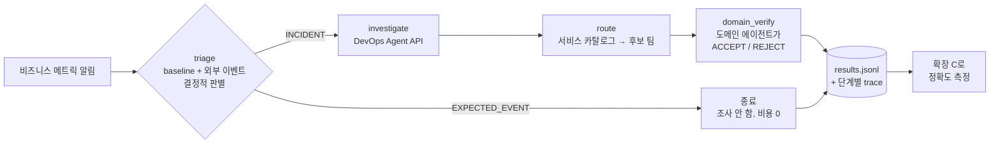

# 실습 · 메인 에이전트에 DevOps Agent 붙이기 (1:25–1:55)

**목표:** 지금 운영 중인 **메인+서브 에이전트 구조**를 축소한 예제로 아래 세 가지를 직접 해봅니다.

1. 판별과 라우팅은 **우리 코드가 결정적으로** 처리합니다.
2. 원인 분석(RCA)만 **DevOps Agent API를 tool로 호출**해 맡깁니다.
3. 단계마다 남긴 기록으로 **라우팅 정확도를 바로 측정**합니다.

코드: [`extensions/triage-router`](https://github.com/hsr87/devops-agent-workshop-kr/tree/main/extensions/triage-router) — 프레임워크 없이 순수 Python으로 작성했습니다. 사용하는 프레임워크(Strands, LangGraph, 사내 프레임워크)와 관계없이 그대로 옮길 수 있습니다.



| 노드 | 누가 결정하나 | 파일 |
|---|---|---|
| `triage` | **코드** (계절성 baseline과 이벤트 캘린더. 확장 B와 같은 로직) | `router.py` |
| `investigate` | **DevOps Agent** (`create_backlog_task` → 폴링 → 조사 기록 수집) | `devops_agent_tool.py` |
| `route` | **코드** (서비스 카탈로그의 owner) | `router.py` |
| `domain_verify` | **도메인 서브에이전트(LLM)**. RCA 근거가 자기 도메인을 가리키는지 판단하고, 아니면 다른 팀을 지목 | `domain_agent.py` |

!!! question "왜 이렇게 나누나요?"
    LLM이 한 번에 "장애인가, 누구 책임인가"를 정하면 **어느 단계에서 틀렸는지 알 수 없습니다.** 노드마다 입력과 출력을 남기면 판별 오류, RCA 오류, 라우팅 오류를 **따로 측정**할 수 있습니다. 측정이 어려웠던 문제를 구조로 푸는 방법입니다.

## 1) 알림 세 건 처리 시작 (1:25)

[Lab 3](lab3.md)의 **Run SRE Agent** 를 먼저 눌러 두고 진행합니다. 두 실습 모두 DevOps Agent 조사가 끝날 때까지 10분 정도 걸립니다.

```bash
source ~/.ext-workshop.env
cd /workshop/ext/extensions/triage-router
$EXT_PYTHON router.py start ../alert-forwarder/samples/impressions-drop-during-match.json \
                            ../alert-forwarder/samples/impressions-crash-during-match.json \
                            ../alert-forwarder/samples/order-errors-spike.json
```

```text
impressions-drop-during-match-…   triage=EXPECTED_EVENT  EXPLAINED_BY_EXTERNAL_EVENT  → closed without investigation (국가대표 축구 경기 생중계 …)
impressions-crash-during-match-…  triage=INCIDENT        UNEXPLAINED_ANOMALY  → DevOps Agent task bc0c… (PENDING_START)
order-errors-spike-…              triage=INCIDENT        UNEXPLAINED_ANOMALY  → DevOps Agent task c094… (PENDING_START)
```

- -26%는 경기 영향으로 설명되므로 **조사 자체를 시작하지 않습니다.** 예상된 변동에 비용을 쓰지 않습니다.
- 나머지 두 건만 DevOps Agent에 넘어갑니다. 콘솔의 **Operator access → Incidents** 에서도 보입니다.

## 2) 기다리는 동안: 코드 읽기 (1:30–1:40)

| 볼 곳 | 볼 것 |
|---|---|
| `devops_agent_tool.py` | DevOps Agent를 tool로 쓰는 데 필요한 API는 **세 개뿐**입니다. `create_backlog_task`, `get_backlog_task`, `list_journal_records`. `LINKED` 상태면 묶인 primary 조사를 따라갑니다. |
| `router.py` `triage()` | 판별은 LLM이 아니라 **규칙**입니다. 판정에 쓴 baseline, 잔차, 이벤트 이름이 trace에 남습니다. |
| `router.py` `investigate()` | 웹훅 경로(확장 A)와 **같은 description**(판별 가이드 포함)을 API로 보냅니다. `clientToken` 으로 중복 생성을 막습니다. |
| `domain_agent.py` | 도메인 에이전트에게 **"RCA에 없는 근거는 지어내지 말라"**, **"아니면 다른 팀을 지목하라"** 고 지시합니다. 기존 서브에이전트 호출로 바꿀 자리입니다. |

```bash
$EXT_PYTHON router.py status      # DevOps Agent 조사 상태
cat runs/*.json | head -60        # 노드별 input / output / 소요 시간
```

!!! info "Lab 3과 같은 Agent Space를 씁니다"
    `order-errors-spike` 는 Lab 3이 조사 중인 order-api와 같은 서비스입니다. 그래서 DevOps Agent가 두 조사를 **같은 장애로 묶을(`LINKED`) 수 있습니다.** 그래도 라우터는 primary 조사의 결과를 가져오므로 그대로 진행됩니다.

## 3) 라우팅과 도메인 검증 (1:40–1:50)

```bash
$EXT_PYTHON router.py finish --wait     # 조사가 끝나면 route → domain_verify → results.jsonl
```

```text
impressions-crash-during-match     INCONCLUSIVE    → ads-serving-team     [NEED_MORE_INFO]
impressions-drop-during-match      EXPECTED_EVENT  → ads-serving-team     [no RCA needed]
order-errors-spike                 INCIDENT        → commerce-order-team  [ACCEPT]
```

위 출력은 Workshop Studio 계정에서 **기대하는** 결과입니다. 사전 검증 계정에는 워크샵 스택이 없어서 order-api 건도 `INCONCLUSIVE` 로 나왔습니다. [사전 검증 결과](../facilitator/test-report.md#router)를 참고하세요.

읽어 볼 것:

- **도메인 에이전트의 `reason`** (`runs/*.json` 의 `domain_verify`). 왜 받았는지, 또는 왜 거절했는지가 근거와 함께 남습니다.
- **`NEED_MORE_INFO` → `INCONCLUSIVE`.** RCA 근거가 부족하면 도메인 에이전트는 억지로 받지 않습니다. 이 결과가 판별 정확도에서는 "틀림"으로 잡힙니다. 그래서 **"모른다"를 어떻게 셀지**도 정의해야 합니다(Part 3).

!!! tip "판별 결과를 DevOps Agent에 넘기는 이유 (사전 검증에서 확인)"
    처음에는 판별 결과 없이 알림만 넘겼습니다. 그러자 DevOps Agent가 판별을 처음부터 다시 하려다 *"event-context MCP가 없어서 INCIDENT인지 EXPECTED_EVENT인지 분류할 수 없다"* 를 핵심 장애물로 기록했습니다.
    `investigate()` 가 **"이미 판별했다: 경기 영향을 빼고도 -49%. 원인에 집중하라"** 를 함께 넘기자 이 장애물이 사라졌고, 조사가 리소스와 원인 추적에 집중했습니다.
    → 메인 에이전트가 이미 아는 맥락은 **반드시 조사 요청에 담아 넘기세요.** MCP를 등록할 수 없는 환경에서도 같은 효과를 얻는 방법입니다.

## 4) 바로 측정하기 (1:50–1:55)

라우터가 남긴 `results.jsonl` 은 [확장 C](ext-eval.md)가 읽는 형식 그대로입니다. 이 세 시나리오의 정답(`ground_truth.jsonl`)을 미리 넣어 두었습니다.

```bash
python3 ../rca-eval/evaluate.py ground_truth.jsonl results.jsonl
$EXT_PYTHON ../rca-eval/evaluate.py ground_truth.jsonl results.jsonl --judge   # RCA 일치도까지
```

사전 검증 계정에서 나온 결과입니다(워크샵 스택 없음).

```text
- Verdict accuracy (incident vs. expected event): 33.3% (1/3)
- Routing accuracy on true incidents: 100.0% (2/2)

| impressions-crash-during-match | INCIDENT | INCONCLUSIVE | OK | MATCH: The agent reports that no ads-serving workload exists ... |
| order-errors-spike             | INCIDENT | INCONCLUSIVE | OK | MISS: ... never identifies the actual cause (memory exhaustion / OOM) ... |
```

!!! question "토론: 이 숫자를 어떻게 읽어야 할까요?"
    - 라우팅은 100%인데 판별은 33%입니다. 판별 오류 두 건은 모두 "장애인데 **모른다**고 답한" 경우입니다. 장애를 정상으로 판단한 경우는 없습니다. 둘은 위험도가 전혀 다릅니다.
    - 단계별로 기록했기 때문에 어느 단계를 고쳐야 하는지 바로 보입니다. 여기서는 판별이나 라우팅이 아니라 **RCA에 필요한 데이터 접근**이 문제입니다.
    - 지금 운영 중인 메인+서브 구조에서는 이 세 숫자를 따로 낼 수 있나요?

## 우리 구조에 대입하기

| 이 예제 | 운영 환경에서 바꿀 곳 |
|---|---|
| `triage()` 의 `explain_deviation` | 사내 이상 탐지와 이벤트 캘린더 |
| `route()` 의 서비스 카탈로그 | 사내 서비스 카탈로그, on-call 체계 |
| `domain_agent.ask()` | **기존 도메인 서브에이전트 호출** (HTTP, Lambda, A2A) |
| `devops_agent_tool.py` | 그대로 사용. 메인 에이전트에 tool 하나로 추가 |
| `runs/*.json` trace | AgentCore Observability 또는 사내 로그 저장소 |

!!! warning "반대 방향(DevOps Agent → 기존 에이전트) 연결은 계정에 따라 막혀 있습니다"
    DevOps Agent가 조사 도중 기존 에이전트를 직접 부르게 하려면 기존 에이전트를 **원격 A2A 에이전트**로 등록해야 합니다(`register-service --service remoteagent`). 사전 검증 계정에서는 MCP 등록과 똑같이 *"Only external accounts and exempted accounts are allowed at this time"* 오류로 거부되었습니다. 그래서 이 실습은 **메인 에이전트가 주도권을 갖는 방향**으로 구성했습니다. 이 방향은 계정 제한 없이 동작합니다. → [사전 검증 결과](../facilitator/test-report.md)
