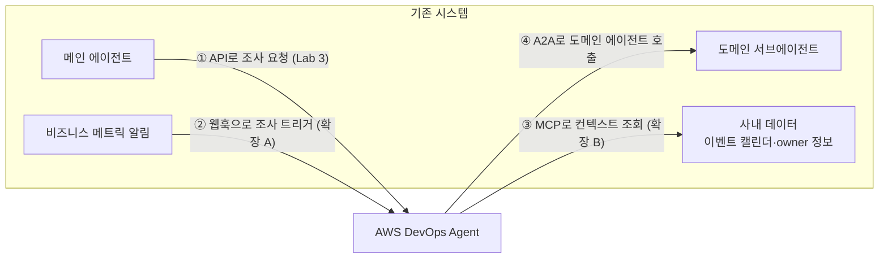

# Part 2 · 기존 Agent와의 연결 (1:10–2:00)

> *"If you already have SRE agents or operational workflows, you don't need to replace them. You can integrate AWS DevOps Agent alongside your existing tools."* — 원본 Lab 3

이미 메인+서브 에이전트 구조나 알림 시스템이 있다면, 이를 버리고 갈아탈 필요가 없습니다. **양방향으로 연결**하면 됩니다.

| 방향 | 방법 | 오늘 다루는 곳 |
|---|---|---|
| ① 기존 에이전트 → DevOps Agent | DevOps Agent API를 **tool** 로 호출 | [Lab 3](lab3.md), **[실습 · 메인 에이전트에 붙이기](ext-router.md)** |
| ② 기존 알림 → DevOps Agent | **Generic webhook** (HMAC 또는 API key) | [확장 A](ext-alert.md) |
| ③ DevOps Agent → 사내 데이터 | 사내 **MCP 서버** 등록 (Streamable HTTP, 공개 HTTPS) | [확장 B](ext-mcp.md) |
| ④ DevOps Agent → 기존 에이전트 | **원격 A2A 에이전트** 등록 (`remoteagent`) | [아키텍처](architecture.md#a2a) (계정 제한으로 설명만) |
| 운영 배포와 신뢰성 | AgentCore Runtime / Memory / Observability, 정확도 평가 | [Lab 4·5 아키텍처](demo.md), [확장 C](ext-eval.md) |

## 타임라인

| 시간 | 내용 | 형태 |
|---|---|---|
| 1:10–1:20 | [멀티에이전트 패턴과 우리 구조 비교](architecture.md) | 설명 + 토론 |
| 1:20–1:25 | [Lab 3](lab3.md): 4-에이전트 파이프라인 **실행만 걸어두기** | 실습 |
| 1:25–1:55 | **[실습 · 메인 에이전트에 DevOps Agent 붙이기](ext-router.md)**: 판별 → DevOps Agent RCA → 라우팅 → 도메인 검증 → 정확도 측정. 기다리는 동안 Lab 3 결과도 확인 | **실습** |
| 1:55–2:00 | [Lab 4·5 아키텍처](demo.md) 그림 설명, 확장 [A](ext-alert.md) · [B](ext-mcp.md) 소개 | 진행자 설명 |

!!! tip "먼저 끝난 분은"
    [확장 A](ext-alert.md)로 같은 알림을 **웹훅 경로**로 보내 보세요. Part 1에서 만든 웹훅을 그대로 씁니다. API 경로(메인 에이전트가 주도)와 웹훅 경로(알림 시스템이 바로 트리거)를 비교할 수 있습니다.
